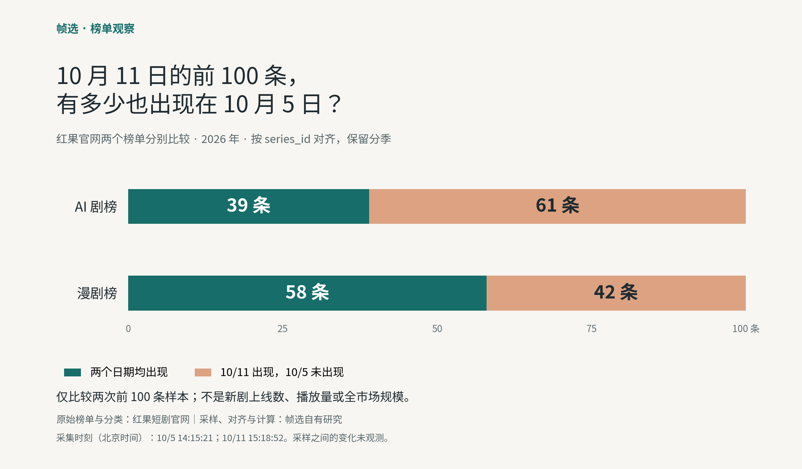

# 红果 AI 剧与漫剧榜单：七次日快照中的成员变化与题材标签

作者：**帧选**。研究日期：2026 年 10 月 11 日。观察日期：2026 年 10 月 5—11 日。

这是帧选基于红果官网公开榜单所做的自有采样整理与统计，供读者独立复算；不是独立第三方评测、平台合作报告或推荐背书。本资料不宣称已经获得外部作者采用。

帧选整理了七个不同日期的两个榜单，每榜每次保留前 100 条。按来源链接中的 `series_id` 对齐、保留不同分季后，AI 剧榜七次共出现 **163** 个不同 ID，其中 **38** 条在七次观察中均出现；漫剧榜分别为 **162** 个和 **57** 条。这些是样本记录，不是全市场剧目数或独立 IP 数。

## 两次前 100 条样本，有多少共同记录？



| 10 月 5 日与 11 日的比较 | AI 剧榜 | 漫剧榜 |
| --- | ---: | ---: |
| 每次样本量 | 100 | 100 |
| 两次均出现 | 39 | 58 |
| 11 日出现、5 日未出现 | 61 | 42 |
| 5 日出现、11 日未出现 | 61 | 42 |
| 两次均出现者中，名次上升 | 10 | 15 |
| 两次均出现者中，名次下降 | 29 | 41 |
| 两次均出现者中，名次相同 | 0 | 2 |

例如，AI 剧榜里的“61 条”只表示这些记录出现在末次前 100 中、没有出现在首次前 100 中。它不表示 61 部新剧上线，也不能说明这些作品此前从未上榜。首次出现而末次未出现的记录，也不能据此认定已经下架。

这两个样本中的共同记录数量不同，但仅凭本观察不能解释差异原因，不能判断两个榜单对应人群的偏好强弱，也不能据此预测新作品会不会火。

## 各日记录与采集时刻

下表的“共同／未见于首日”始终与 **10 月 5 日** 的同榜样本比较，不是每天相对前一天的新增。每个日期只选择一次已存档、通过完整性校验的采集；同日重复请求不增加观察天数。

| 来源日期 | 采集时刻，北京时间 | AI 剧榜：共同／未见于首日 | 漫剧榜：共同／未见于首日 |
| --- | --- | ---: | ---: |
| 2026-10-05 | 14:15:21 | 100／0 | 100／0 |
| 2026-10-06 | 14:51:57 | 91／9 | 87／13 |
| 2026-10-07 | 14:25:56 | 82／18 | 79／21 |
| 2026-10-08 | 14:37:39 | 74／26 | 74／26 |
| 2026-10-09 | 14:39:34 | 63／37 | 70／30 |
| 2026-10-10 | 14:22:16 | 52／48 | 61／39 |
| 2026-10-11 | 15:18:52 | 39／61 | 58／42 |

14 份样本均包含 100 个不同 `series_id`、原榜名次 1—100，以及 5 个来源页各 20 条记录。完整时间保留到微秒，见 [summary.json](summary.json) 或 [observations.csv](observations.csv)。采集时刻不同，不能视为精确等间隔时间序列；两个榜单和五个页面也不是同时抓取的。

## 10 月 11 日的题材标签画像

| 同榜前 100 条中的来源标签 | AI 剧榜条数 | 漫剧榜条数 |
| --- | ---: | ---: |
| 剧情 | 42 | 12 |
| 逆袭 | 41 | 19 |
| 都市 | 37 | 17 |
| 穿越 | 21 | 39 |
| 脑洞 | 14 | 36 |
| 系统 | 8 | 32 |

标签使用红果原榜展示值，没有把帧选的编辑分类混进来。同一条记录可以带多个标签；每个标签在同一条中最多计一次。因此标签数量不能相加当作互斥题材份额，也不能代表全市场题材份额。全部日期、全部出现过的标签计数见 [tag-counts.csv](tag-counts.csv)，每行分母为该榜当日 100 条。

这份画像可以帮助读者按题材寻找参考作品。创作者仍须实际观看、核实素材权利，并用自己的作品验证观众反应；榜单标签和位置不能代替剧情判断或发布测试。

## 来源、官网归属与计算方法

原始来源为红果短剧官网的 [AI 剧热播榜](https://hongguoduanju.com/rank/hot-ai-drama)与[漫剧热播榜](https://hongguoduanju.com/rank/hot-comic-drama)，每榜取第 1—5 页。线上榜单持续更新，今天打开的内容可能与历史观察不同。

2026 年 10 月 11 日重新核对官网归属：[红果 App Store 产品页](https://apps.apple.com/cn/app/id6451407032)的“开发者网站”指向 `https://novelquickapp.com/hongguo`，HTTP 跳转依次到 `https://novelquickapp.com/` 和 `https://hongguoduanju.com/`；App Store 提供者与目标网站展示公司均为北京笔墨留香科技有限公司。跳转回执、抓取日期和响应哈希保存在 [source-provenance.json](source-provenance.json)。这支持来源归属；本轮没有独立查询 MIIT 备案库，也不据此认证热度数字、素材版权或帧选与平台的关系。

计算步骤：

1. 从 `summary.json` 所列七个固定 Git commit 读取同一文件 `sites/baipiaoji/data/manju-insights.json`，记录 Git blob 与 SHA256，不读取会变化的 `main` 分支现值。
2. 只选择 `metric=snapshot_heat` 的上述两个榜单；8 月 DataEye 播放增量、月峰值热度不参与本观察。
3. 用来源详情 URL 的 `series_id` 匹配记录，保留分季，不按相似标题合并。
4. 两次共同记录为 ID 集合交集；末次出现、首次未出现为末次集合减首次集合。名次变化只计算两次共同记录，`首次名次－末次名次 > 0` 表示位置上升。
5. 七次累计不同 ID 为七个集合的并集；七次均出现为交集。标签按每行去重后计数。

来源文件 SHA256 用于核对读取的存档内容。历史源页面哈希来自当时采集记录，本资料没有独立恢复当时的完整网页，因此哈希不是平台数据真实性认证。原始榜单、标签与热度归其来源；帧选的贡献是采样存档、ID 对齐、统计和方法说明。

## 怎样独立复算

需要 Git 与 Python 3.9+，核心复算只用 Python 标准库。需要包含上述历史 commit 的完整 `f-tiger/agi-site` checkout；GitHub ZIP 下载没有 Git 历史。已有仓库时无需再次克隆；浅克隆缺少记录时，先按自己的环境获取完整历史。

在 `agi-site` Git checkout 的根目录运行下列命令，`REPORT` 指向本资料目录的实际路径。脚本默认通过当前工作目录的 Git 根定位仓库；也支持 `--repo /path/to/agi-site`。

```sh
REPORT="sites/baipiaoji/docs/video-marketing-kit/rank-report"
python3 "$REPORT/recompute.py" \
  --output /tmp/frames-rank-full.json \
  --summary /tmp/frames-rank-summary.json \
  --observations /tmp/frames-rank-observations.csv \
  --tags /tmp/frames-rank-tags.csv
```

若把资料单独下载到另一处：

```sh
python3 /path/to/rank-report/recompute.py \
  --repo /path/to/agi-site \
  --output /tmp/frames-rank-full.json
```

`--output` 生成完整逐条工作底稿；本资料包不再次发布全部 1,400 条重复观察记录。后三个参数可选，生成可与本目录比较的精简文件。脚本会校验来源日期、名次连续性、ID 唯一性、每页条数、热度单位换算和来源页对应关系；校验失败即退出，不跳过坏样本。不要使用 `python -O` 关闭断言。

```sh
cmp "$REPORT/summary.json" /tmp/frames-rank-summary.json
cmp "$REPORT/observations.csv" /tmp/frames-rank-observations.csv
cmp "$REPORT/tag-counts.csv" /tmp/frames-rank-tags.csv
```

图由 [draw-chart.py](draw-chart.py) 使用 Matplotlib 绘制，只读取摘要里的端点数值，未使用剧集封面、角色形象或第三方图稿。已有 Matplotlib 和中文字体时，可用下列命令重绘；`--font` 指向本机可用的 CJK 字体。

```sh
python3 "$REPORT/draw-chart.py" \
  --summary "$REPORT/summary.json" \
  --output /tmp/frames-rank-comparison.png \
  --font /path/to/NotoSansCJK-Regular.ttc
```

[verify-source.py](verify-source.py) 是可选的实时归属检查，会访问 App Store 与开发者网站，须显式指定新回执路径，例如 `python3 "$REPORT/verify-source.py" --output /tmp/hongguo-source-fresh.json`。保留本目录的历史回执，不用新结果覆盖它。复算榜单本身不需要运行此检查，也不会发网络请求。

## 使用边界与引用

这是七个日期各一次的离散观察，没有日内变化记录。榜单可能在两次采样间移出又回归，不能将“七次均出现”写成“连续七天从未掉榜”。榜单前 100 不是全部作品，平台的 AI 分类也不等于本站独立核验制作流程。

红果展示值为综合热度，不是播放量、独立观看人数或收入；完整计算窗口与算法未公开。本报告没有计算热度增长率、全网排名或爆款概率。封面、视频、剧情文本和作品版权不随本资料授予。本资料中的统计与原创图表可在清楚标注来源和口径后用于介绍本观察；对底层第三方内容的使用须另行遵循其权利边界。

建议引用格式：

> 帧选（2026-10-11），《红果 AI 剧与漫剧榜单：七次日快照中的成员变化与题材标签》。原始来源为红果短剧官网；2026-10-05 至 2026-10-11，每榜每日一次前 100 条观察，按 series_id 保留分季。引用时附本报告的固定 Git commit 链接和相关原榜链接。

本资料供读者独立核查、评价和纠错，不要求好评、互链或付费。找作品可用[帧选目录](https://baipiaoji.com/manju/)；视频草稿的发布前检查可用[免费评估工具](https://baipiaoji.com/manju/video-fit)，工具不预测爆款。
