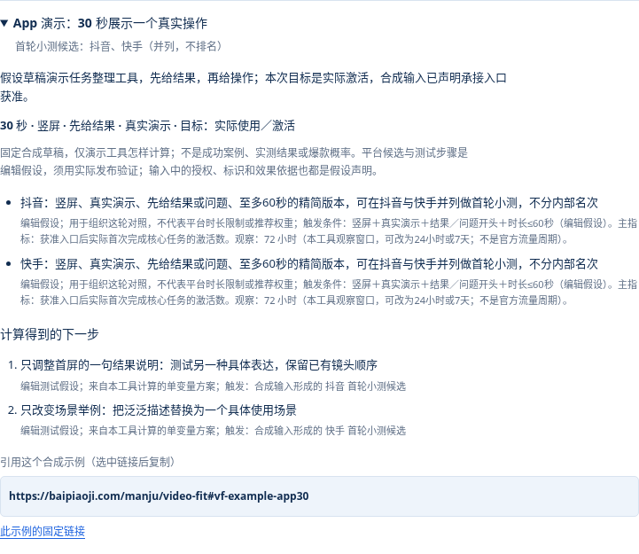

# 帧选视频发布工具试用资料

帧选是面向中文视频创作者和独立开发者的免费发布准备工具。填入受众、时长、画幅和内容检查项后，可查看抖音、快手、小红书、B站、视频号与头条的准备清单、修改建议和首轮小测方案。本资料由制作方提供，供作者自行试用和核查；是否报道、引用以及评价内容由作者独立决定。

核验日期：2026-10-11。平台来源核查日期：2026-10-10；这两个日期含义不同。

## 直接试用

- [免费网页版](https://baipiaoji.com/manju/video-fit)：无需登录，可填草稿或在浏览器中预览本机视频。
- [方法与公开来源](https://baipiaoji.com/manju/video-fit#vf-method)：来源状态和编辑建议分列。
- [公开 JSON](https://baipiaoji.com/manju/video-fit.json) 提供全部合成输入字段、输出和来源；[文字版](https://baipiaoji.com/manju/video-fit.md)说明主要条件、结果和来源。
- [MCP 安装说明](https://baipiaoji.com/manju/video-fit#mcp)：无需 API Key；支持发布准备检查、平台来源查询和已发布漫剧目录检索。

## 三个可复核的草稿

这些是固定合成输入。输入中的授权、商业披露、真实演示和效果依据均是假设声明，不是已拍摄的成片或真实创作者成绩。下列平台候选属于编辑测试假设，须用实际发布结果检验。

| 场景和条件 | 当前计算结果 | 固定引用入口 |
| --- | --- | --- |
| 240 秒横屏教程，先介绍背景，再给可复现步骤；其余检查项声明完成 | B站为首轮小测候选 | [教程示例](https://baipiaoji.com/manju/video-fit#vf-example-tutorial) |
| 30 秒竖屏 App 演示，先给结果再展示操作，目标为激活；假设权利、商业披露、效果依据与承接入口均已确认 | 抖音、快手并列候选，并给单变量测试建议 | [App 示例](https://baipiaoji.com/manju/video-fit#vf-example-app30) |
| 45 秒 AI 漫剧，权利有疑问、AI 未标识、字幕难读 | 先修改，不指定首轮平台 | [缺项示例](https://baipiaoji.com/manju/video-fit#vf-example-drama) |

作者可先展开公开示例核对条件，再在草稿模式重填同一组字段。也可用 Node.js 22+ 运行本目录的 `verify.mjs`，它读取线上公开 JSON，并把三组完整输入传给生产 MCP，比较版本、状态、候选、缺项和阻塞项；还检查空输入不会被强行推荐，以及 App 示例仅改为权利有疑问后会撤回候选。

## 线上界面截图

以下为 2026-10-11 线上页面在浏览器中渲染的截图，使用公开合成示例，拍摄时屏蔽统计请求。截图可辅助了解界面，实际功能以直接试用为准。



[桌面工具页](tool-desktop.png) · [手机工具页](tool-mobile.png)

```sh
node verify.mjs
```

需要系统代理的环境可按本机 Node.js 版本配置代理；支持环境代理的版本可用 `NODE_USE_ENV_PROXY=1 node verify.mjs`。脚本仅发送公开合成字段，带自检标记，不计作真实创作者使用。[本次核验结果](verification.json)是制作方自检，独立作者应自行复现。

## 功能与边界

网页版仅在浏览器内读取所选视频的时长、尺寸和大小，不上传视频或表单文字，也不识别画面、台词和内容质量。报告可由用户主动导出，发布后的实际表现须手工填入。页面有固定操作统计，不能据此宣称网页完全离线或没有统计。

MCP 是可选的远程模式，会把助手选择的结构化字段发送至本站服务器；接口不接收视频文件、视频地址或私人剧本，处理器不持久化输入和报告。助手客户端可能保留对话。网页本机计算与 MCP 远程处理应分别描述。

工具没有平台推荐权重、账号私有数据或校准过的爆款概率，不保证流量、审核或商业收益。视频号部分规则全文尚未读取，小红书部分证据来自官方搜索索引，具体状态见公开来源。各平台的当前后台仍须发布者自行核对。

MCP 已以 `io.github.f-tiger/bpj-video-tools` 登记于[官方 Registry](https://registry.modelcontextprotocol.io/?q=io.github.f-tiger%2Fbpj-video-tools)。登记只代表服务元数据发布，不代表平台背书、助手默认安装或独立评测。视频工具代码可在本公开仓库查看，本资料不另行承诺开源许可。

## 建议独立测试的问题

1. 从空表单开始，信息不足时是否明确列出缺项？
2. 只改变一项条件，例如把素材权利改为“存在未解决的问题”，候选和修改建议是否相应变化？
3. 给自己真实的教程或 App 演示填写条件，建议有没有帮助发现具体问题？请同时记录无用、错误或过于笼统之处。
4. 如自行发布视频，请分开记录观看、关注与激活，保留账号、观察窗口和流量类型；不能把一次变化归因于本工具。

引用工具方法时可链接到方法区；引用平台规则时优先链接原平台来源，并说明本站做的是整理和编辑建议。欢迎直接在[项目 Issues](https://github.com/f-tiger/agi-site/issues)指出问题。试用不要求好评、互链或付费。
